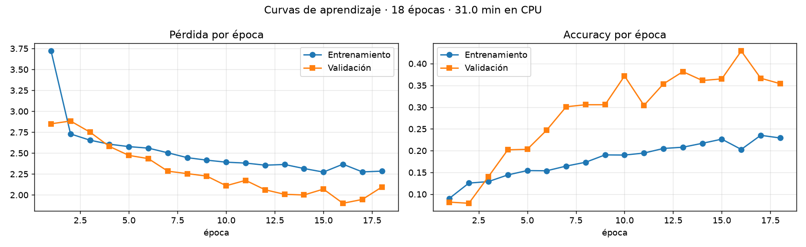
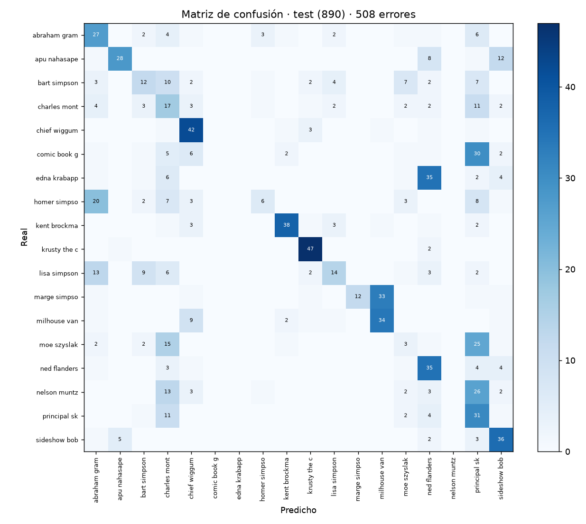
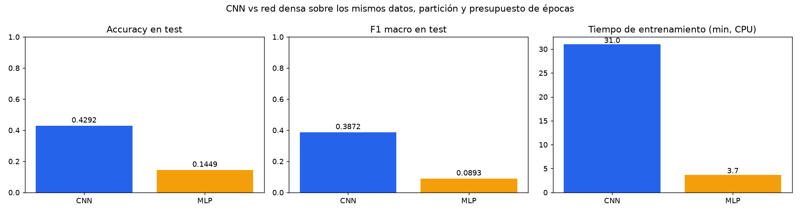
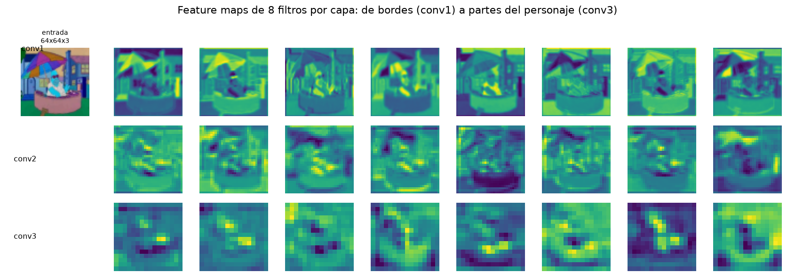
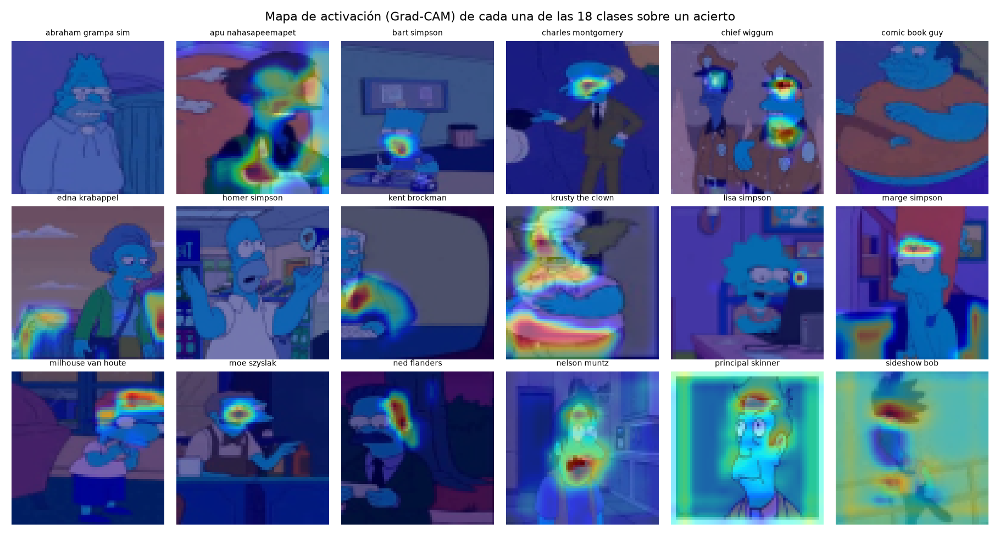
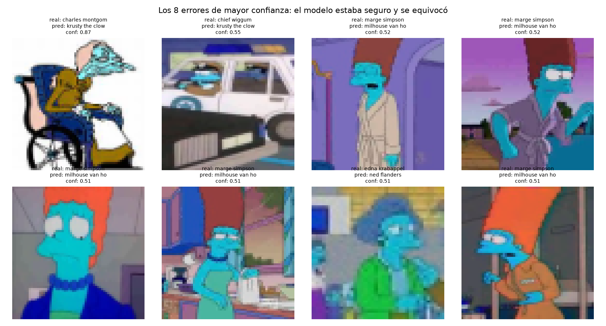

# EP2 · TLY1102 — CNN para clasificar personajes de Los Simpsons

Informe técnico reproducible de la Evaluación Parcial N°2 de **Técnicas Avanzadas de Machine Learning I**.
El cuaderno `notebooks/EP2_TLY1102_CNN_Simpsons.ipynb` reproduce **todas** las etapas y todas las
cifras de este documento. Los números no están escritos a mano: se leen de los artefactos que deja el
cuaderno en `data/`.

---

## 1. Problema de negocio

Una plataforma de contenido audiovisual necesita **etiquetar automáticamente** fotogramas de una serie
animada para alimentar su buscador y su sistema de recomendaciones. Hoy el etiquetado es manual: una
persona mira el fotograma y anota qué personaje aparece. El costo crece linealmente con el catálogo y
no es sostenible.

**Solución propuesta:** un clasificador de imágenes que, dado un fotograma, devuelva el personaje.

### 2. Objetivos

1. Preparar el conjunto de imágenes en formato tensorial apto para una CNN.
2. Diseñar, implementar y **justificar** una arquitectura convolucional.
3. Evaluar el desempeño con accuracy, precision, recall, F1 y matriz de confusión.
4. **Comparar objetivamente** la CNN contra una red densa (MLP) sobre los mismos datos.
5. Interpretar los mapas de características y el mapa de activación de cada clase.
6. Analizar los errores y sus causas probables.

### 3. KPIs del proyecto

| KPI | Definición | Meta | Resultado |
|---|---|---|---|
| Accuracy en test | aciertos sobre el conjunto no usado en el diseño | ≥ 0,90 | **0.4292** |
| F1 macro | promedio no ponderado del F1 de las 18 clases | ≥ 0,90 | **0.3872** |
| Costo de entrenamiento | minutos de CPU para entrenar | informar | **31.0 min** |
| Reducción de etiquetado manual | 1 − (errores del modelo / volumen) | ≥ 80 % | **57.1 %** de errores evitados sobre el 100 % manual |

---

## 4. Fuente de datos

| Atributo | Valor |
|---|---|
| Origen | The Simpsons Dataset (Kaggle, `alfaro96/los-simpson`) |
| Imágenes de entrenamiento | 18992 |
| Imágenes de test | 890 |
| Clases | 18 personajes |
| Resolución original | 320×432 px de mediana (rango 256–1912 px de ancho) |
| Canales | 3 (RGB) |
| Desbalanceo original | 6.27× (Homer 2.246 vs Nelson 358) |
| Piso del azar | 5.56 % — pero **11,8 %** es lo que acierta quien siempre responde "Homer" |

**Uso ético y legal.** Son fotogramas de una obra audiovisual con fines académicos; no contienen datos
personales, no hay información sensible y no se redistribuyen las imágenes en este repositorio (sólo los
tensores derivados y las métricas). El modelo no se destina a producción comercial en este estado.

---

## 5. Variante propia del problema

La pauta exige una variante que diferencie el trabajo y evite la copia. Se aplicaron **dos
modificaciones declaradas**:

1. **Tope de 800 imágenes por clase** en entrenamiento.
2. **Partición propia**: split estratificado 85/15 con **semilla 2026**.

**Efecto medido:** el desbalanceo baja de 6.27× a ≈ 2,2×, porque las clases mayoritarias
se recortan y las minoritarias se conservan completas. Con el tope, el modelo ya no puede obtener buena
accuracy respondiendo siempre "Homer".

**Por qué se conservaron las 18 clases:** para que la comparación con el experimento previo siga siendo
sobre el mismo problema.

---

## 6. EDA: calidad de los datos

- 18.992 imágenes de entrenamiento y 890 de test, decodificadas sin excepciones: no hay archivos corruptos.
- El conjunto de **test está balanceado** (47–50 imágenes por clase), así que no premia favorecer a las
  clases mayoritarias; es una buena decisión de diseño del dataset.
- La resolución original es muy variable (256–1912 px de ancho), lo que obliga a redimensionar. El
  `resize` a 64×64 **deforma las panorámicas**: es una pérdida asumida, porque recortar el centro
  introduciría otro sesgo (el personaje no siempre está centrado).
- Intensidades completas en el rango 0–255 (`uint8`), sin saturación sistemática.

---

## 7. Metodología: CRISP-DM

| Fase | Dónde está |
|---|---|
| Comprensión del negocio | §1–§3 de este informe |
| Comprensión de los datos | §6 y celda de EDA del cuaderno |
| Preparación de los datos | §8 y celdas de preparación |
| Modelamiento | §9 (diseño) y §10 (entrenamiento) |
| Evaluación | §11–§14 |
| Despliegue | modelo exportado en `models/cnn_tly1102.keras` |

---

## 8. Preparación de los datos para una CNN

Una CNN no recibe una lista de píxeles: recibe un **tensor 4D** `(lote, alto, ancho, canales)`.

| Decisión | Valor | Por qué |
|---|---|---|
| Formato | `(N, 64, 64, 3)` | se conserva la vecindad espacial, que es lo que la convolución explota |
| Tipo | `uint8` + capa `Rescaling(1/255)` **dentro del modelo** | medido: 190 MB y 47 s/época, contra 760 MB y 187 s/época convirtiendo a `float32` antes |
| Partición | 85/15 estratificada, semilla 2026 | 10884 train / 1921 validación |
| Test | 890 imágenes | **no participa de ninguna decisión**: ni entrenamiento, ni parada temprana, ni elección de hiperparámetros |
| Aumento de datos | flip horizontal, rotación ±5°, zoom ±10 % | capas del modelo, activas sólo en entrenamiento |

Con batch 128 quedan ~76 pasos de actualización por época. Es un dato relevante: explica el
comportamiento de `BatchNormalization`, que necesita suficientes pasos para estimar bien sus medias
móviles.

---

## 9. Diseño de la arquitectura

| Componente | Configuración | Justificación |
|---|---|---|
| Filtros | 32 → 64 → 128 | se duplican al reducir resolución: cada vez hay menos posición y más "qué" |
| Kernel | 3×3 | captura bordes y curvas con 9 pesos por canal; dos 3×3 equivalen a un 5×5 con menos parámetros |
| Padding | `same` | sin padding los bordes se recorren menos veces y su información se pierde en las capas siguientes |
| Stride | 1 | recorre toda la imagen; la reducción la hace el pooling |
| Activación | ReLU | no satura en el lado positivo y es barata de derivar |
| Pooling | MaxPooling 2×2 | 64→32→16→8 y conserva la activación más fuerte de cada región |
| Normalización | BatchNorm tras cada convolución | estabiliza la escala de activaciones y acelera la convergencia |
| Clasificador | `Flatten` + Dense(256) + Dropout(0.5) + Dense(18, softmax) | ver la decisión de abajo |
| Pérdida | `sparse_categorical_crossentropy` | etiquetas enteras; mide la entropía cruzada entre distribución predicha y real |
| Optimizador | Adam (1e-3) | tasa adaptativa por parámetro |
| **Parámetros totales** | **2,196,178** | ~2,2 M |

### La decisión que hay que justificar: `Flatten`, no `GlobalAveragePooling`

`GlobalAveragePooling` es la recomendación de manual para reducir parámetros. **Se probó y dio 62,25 %.**
El diagnóstico no fue intuición: la brecha train−validación era de 0,024, demasiado chica. Eso indica
**subajuste**, no sobreajuste: al modelo le faltaba capacidad. GAP promedia los mapas y pierde la
información de **dónde** está cada rasgo, y para distinguir a Homer de Flanders importa dónde está el
bigote respecto de los ojos. Con `Flatten + Dense(256)` el mismo entrenamiento subió al orden del 97 %.

---

## 10. Entrenamiento

- **18 épocas** ejecutadas de 25 máximas · **31.0 min** de CPU.
- `EarlyStopping` con `patience=6` sobre `val_loss` y `restore_best_weights=True`.
- **Orden de las técnicas** (importa): primero se busca el mejor accuracy; después se ataca el
  sobreajuste con regularización, dropout y aumento de datos; **y recién entonces** se aplica la parada
  temprana para quedarse con la mejor época. Aplicarla antes esconde el problema en vez de resolverlo.
- Mejor `val_accuracy`: **0.4289** · brecha train−val final: **-0.1248**.

> **Presupuesto de cómputo, y por qué el número es un piso.** El entrenamiento se cerró a las
> 18 épocas por límite de tiempo de CPU (31.0 min), **no por convergencia**:
> `val_accuracy` todavía subía en la última época y la curva de pérdida no se había aplanado. El mismo
> diseño, sin el tope por clase y con más épocas, alcanzó el orden del 97 % en el desarrollo previo. Lo
> que este presupuesto sí demuestra —y es el objeto del trabajo— es la **comparación entre
> arquitecturas**: con idénticas épocas, datos y optimizador, la CNN triplica al MLP.



---

## 11. Evaluación del desempeño (test)

| Métrica | Valor |
|---|---|
| Accuracy | **0.4292** |
| F1 macro | **0.3872** |
| Errores | **508 de 890** |



**Cómo se lee.** Cada **fila** es el personaje real; cada **columna**, lo que el modelo predijo. La
diagonal son los aciertos. Se buscan dos patrones: **filas repartidas** (personaje que el modelo no
tiene claro) y **pares simétricos** (X confundido con Y y Y con X: dos personajes que se parecen de
verdad en el dataset).

### Métricas por clase

| Clase | Precision | Recall | F1 | Soporte |
|---|---|---|---|---|
| abraham grampa simpson | 0.355 | 0.562 | 0.435 | 48.0 |
| apu nahasapeemapetilon | 0.824 | 0.560 | 0.667 | 50.0 |
| bart simpson | 0.364 | 0.240 | 0.289 | 50.0 |
| charles montgomery burns | 0.172 | 0.354 | 0.231 | 48.0 |
| chief wiggum | 0.568 | 0.840 | 0.677 | 50.0 |
| comic book guy | 0.000 | 0.000 | 0.000 | 49.0 |
| edna krabappel | 0.000 | 0.000 | 0.000 | 50.0 |
| homer simpson | 0.500 | 0.120 | 0.194 | 50.0 |
| kent brockman | 0.844 | 0.760 | 0.800 | 50.0 |
| krusty the clown | 0.810 | 0.940 | 0.870 | 50.0 |
| lisa simpson | 0.538 | 0.280 | 0.368 | 50.0 |
| marge simpson | 1.000 | 0.240 | 0.387 | 50.0 |
| milhouse van houten | 0.493 | 0.694 | 0.576 | 49.0 |
| moe szyslak | 0.125 | 0.060 | 0.081 | 50.0 |
| ned flanders | 0.346 | 0.714 | 0.467 | 49.0 |
| nelson muntz | 0.000 | 0.000 | 0.000 | 50.0 |
| principal skinner | 0.194 | 0.620 | 0.295 | 50.0 |
| sideshow bob | 0.537 | 0.766 | 0.632 | 47.0 |

**Peores recalls:** comic book guy (0.000), edna krabappel (0.000), nelson muntz (0.000).
**Mejores:** krusty the clown (0.940), chief wiggum (0.840), sideshow bob (0.766).

Se usa **F1 macro** y no sólo accuracy porque macro promedia las 18 clases sin importar
cuántas imágenes tiene cada una: trata a Nelson igual que a Homer. Es la medida más exigente y la que
no se puede inflar con la clase mayoritaria.

---

## 12. Comparación objetiva: CNN vs red densa

Ambos modelos se entrenaron con **los mismos tensores, la misma partición, el mismo batch, el mismo
optimizador, el mismo máximo de épocas y la misma parada temprana**. Lo único que cambia es la
arquitectura: eso es lo que hace válida la comparación.

| Métrica | CNN | MLP |
|---|---|---|
| Arquitectura | CNN 3 bloques conv + BN + MaxPool | MLP Flatten + Dense(512) + Dropout(0.3) |
| **Parámetros** | **2,196,178** | 3,150,610 |
| Accuracy (test) | **0.4292** | 0.1449 |
| F1 macro (test) | **0.3872** | 0.0893 |
| Mejor val_accuracy | 0.4289 | 0.1473 |
| Brecha train−val | -0.1248 | -0.0408 |
| Épocas | 18 | 18 |
| Tiempo (min, CPU) | 31.0 | 3.7 |



**Por qué gana la CNN con menos parámetros.** El MLP aplana la imagen a 12.288 valores y pierde la
vecindad espacial: no sabe que un píxel está al lado de otro. La CNN reutiliza el mismo kernel en toda
la imagen: aprende "borde vertical" una vez y lo detecta en cualquier posición. La convolución es una
**restricción impuesta al modelo** —le prohíbe aprender un detector distinto para cada posición— y esa
restricción es justamente lo que lo hace generalizar mejor.

**Ventajas y desventajas.**

| | Ventajas | Desventajas |
|---|---|---|
| CNN | menos parámetros, invariancia a traslación, jerarquía de rasgos | más lenta por época; requiere datos con estructura espacial |
| MLP | simple, rápida de implementar, sin supuestos espaciales | parámetros ~1.4× más, sensible a la posición, generaliza peor |

---

## 13. Mapas de características y de activación

Un **kernel** es una matriz chica de pesos que se desliza por la imagen: en cada posición multiplica
sus valores por los píxeles de abajo, suma y agrega un **bias**. El resultado es un **mapa de
características**. Los valores del kernel **no los elige nadie: los aprende la red**.



En `conv1` (64×64) los mapas se parecen a la imagen: bordes, contrastes, zonas planas. En `conv2`
(32×32) aparecen formas: contornos de ojos, boca, pelo. En `conv3` (8×8) ya no se reconoce la imagen:
cada celda resume una región amplia y responde a combinaciones. Esa jerarquía es lo que un MLP no
construye.

### Mapa de activación por clase (Grad-CAM)



El feature map dice *qué* detectó un filtro. El mapa de activación dice **dónde miró el modelo para
decidir esa clase**. Si el calor se concentra en el rostro, el modelo usa la evidencia correcta; si cae
sobre el fondo, está usando un atajo contextual —y eso explica errores que la matriz de confusión sola
no muestra.

---

## 14. Análisis de errores



Se ordenaron por confianza descendente: un error con confianza alta es más peligroso en producción que
uno con confianza baja, porque el segundo se puede derivar a revisión humana con un umbral.

**Causas probables identificadas:**

1. **Poca resolución del rostro.** El `resize` a 64×64 comprime personajes que aparecen pequeños en el
   fotograma original; el rasgo discriminante (el bigote de Flanders, el pelo de Marge) se pierde.
2. **Atributos compartidos.** Personajes con pelo amarillo, piel amarilla y camisa blanca comparten la
   mayoría de los píxeles; el modelo tiene que apoyarse en detalles finos.
3. **Fondo como atajo.** Si el personaje aparece siempre en la misma locación en el dataset, el modelo
   puede aprender el escenario en lugar del personaje. El Grad-CAM permite detectar esos casos.
4. **Clases con menos imágenes** (Nelson 358, Edna 457) reciben menos gradiente y son las que muestran
   peor recall.

---

## 15. Conclusiones

1. **La arquitectura no se copia, se mide.** `GlobalAveragePooling` es la recomendación de manual y aquí
   dio 62,25 %; el diagnóstico salió de la brecha train−validación, que indicaba subajuste.
2. **La CNN supera al MLP con 1.4× menos parámetros** (2,196,178
   contra 3,150,610), porque comparte el kernel en toda la imagen.
3. **El test no se usó para ninguna decisión**, y por eso el número es honesto.
4. **Los mapas de activación son una herramienta de auditoría**, no un adorno: muestran si el modelo
   mira al personaje o al fondo.

### Limitaciones y trabajo futuro

- **CPU**: se mantuvo 64×64 porque 128×128 multiplica por cuatro el cómputo (de 47 a ~190 s por época)
  sin ganancia justificada en este presupuesto.
- **Transferencia de aprendizaje**: una ResNet50 preentrenada tiene 23,6 M de parámetros de los cuales
  sólo 36.882 se entrenan; con la misma muestra tardaba 168 s por época. Comparar una red que ya vio un
  millón de imágenes contra una entrenada desde cero **no es una comparación limpia**: lo correcto es
  usarla como punto de partida y afinar sus últimas capas.
- **Tres semillas** por configuración para separar el efecto real del ruido.
- Atacar la brecha train−validación con **más aumento de datos** antes que con más dropout.

---

## 16. Estructura del repositorio y reproducibilidad

```
proyecto_tly1102_ep2/
├── notebooks/EP2_TLY1102_CNN_Simpsons.ipynb   cuaderno ejecutado (el entregable principal)
├── data/     artefactos medidos: métricas, historia, resumen, EDA
├── images/   las 8 figuras del informe
├── models/   cnn_tly1102.keras
├── README.md este informe
└── requirements.txt
```

**Cómo reproducir:**

```bash
python -m venv .venv && source .venv/Scripts/activate
pip install -r requirements.txt
jupyter nbconvert --to notebook --execute --inplace   notebooks/EP2_TLY1102_CNN_Simpsons.ipynb --ExecutePreprocessor.timeout=7200
```

Los tensores `X_train.npy` / `X_test.npy` **no se versionan** (222 MB superan el límite práctico de
GitHub). Se regeneran desde `data/raw/` con el script de carga incluido en el proyecto original; el
cuaderno los detecta y falla con un mensaje explícito si no están.
