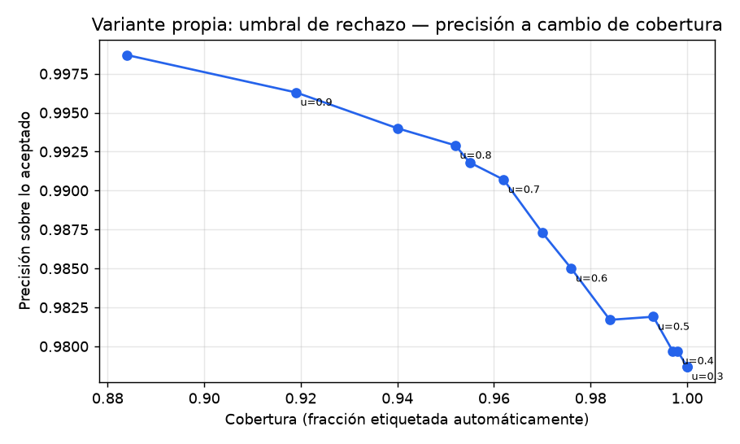
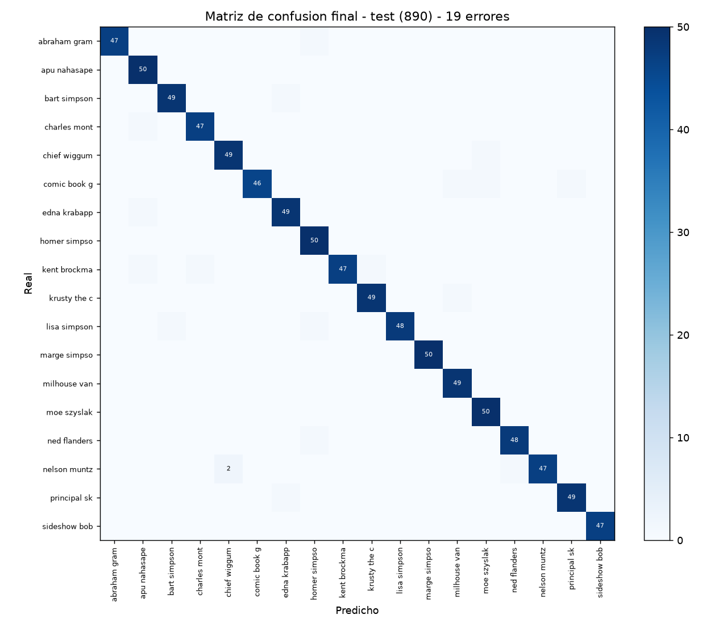
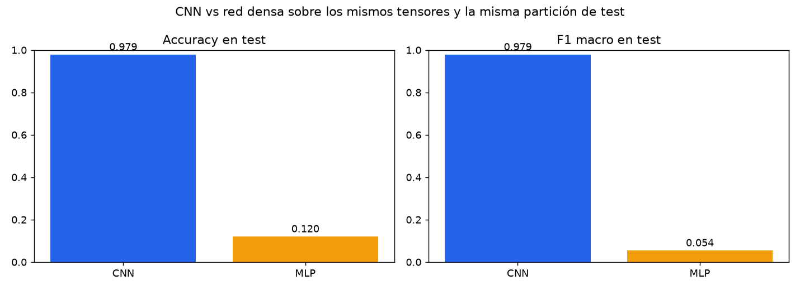
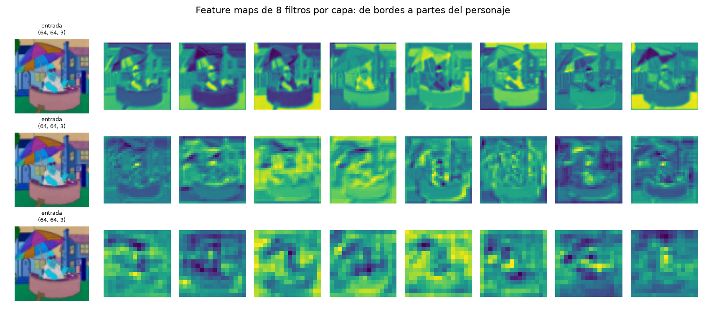
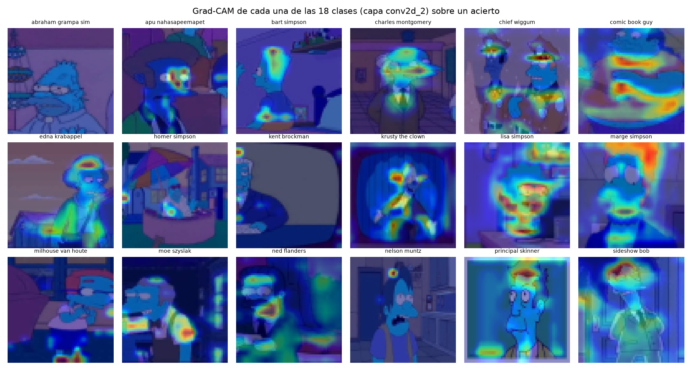

# EP2 · TLY1102 — CNN para clasificar personajes de Los Simpsons

Informe técnico de la Evaluación Parcial N°2 de **Técnicas Avanzadas de Machine Learning I**.
El cuaderno `notebooks/EP2_TLY1102_CNN_Simpsons_final.ipynb` reproduce todas las etapas y todas las
cifras de este documento.

---

## 1. Problema de negocio

Una plataforma de contenido audiovisual necesita **etiquetar automáticamente** fotogramas de una serie
animada para alimentar su buscador y su sistema de recomendaciones. Hoy el etiquetado es manual: una
persona mira el fotograma y anota qué personaje aparece. El costo crece linealmente con el catálogo.

**Solución:** un clasificador convolucional que, dado un fotograma, devuelva el personaje; y cuando no
está seguro, lo derive a revisión humana en lugar de arriesgar una etiqueta falsa.

## 2. Objetivos

1. Preparar el conjunto de imágenes en formato tensorial apto para una CNN.
2. Diseñar, implementar y justificar una arquitectura convolucional.
3. Evaluar con accuracy, precision, recall, F1 y matriz de confusión.
4. **Comparar objetivamente** la CNN contra una red densa sobre los mismos datos.
5. Interpretar los mapas de características y el mapa de activación de cada clase.
6. Analizar los errores y sus causas probables.

## 3. KPIs

| KPI | Definición | Meta | Resultado |
|---|---|---|---|
| Accuracy en test | aciertos sobre un conjunto que no participó del diseño | ≥ 0,90 | **0.9787** |
| F1 macro | promedio no ponderado del F1 de las 18 clases | ≥ 0,90 | **0.9787** |
| Precisión con rechazo | precisión sobre lo etiquetado automáticamente con umbral 0,70 | ≥ 0,99 | **99.07%** |
| Cobertura con rechazo | fracción del volumen etiquetada sin intervención humana | ≥ 0,90 | **96.2%** |

---

## 4. Fuente de datos

| Atributo | Valor |
|---|---|
| Origen | The Simpsons Dataset (Kaggle, `alfaro96/los-simpson`) |
| Imágenes de entrenamiento | 18992 |
| Imágenes de test | 890 |
| Clases | 18 personajes |
| Resolución original | 320×432 px de mediana (rango 256–1912 px de ancho) |
| Canales | 3 (RGB) |
| Desbalanceo | 6.27× (Homer 2.246 vs Nelson 358) |

> **Sobre el cambio de conjunto de datos.** El trabajo anterior de esta asignatura usaba imágenes
> **monocanal de 28×28** con letras aisladas sobre fondo limpio. Este conjunto es **tricanal RGB** con
> fondo complejo y resolución variable. Comparar una CNN pensada para el primero contra una red densa
> entrenada sobre el segundo cambiaría dos cosas a la vez —arquitectura y naturaleza del dato— y la
> comparación exigida perdería validez. Por eso se trabaja sobre el conjunto RGB, que es además el que
> la pauta autoriza explícitamente.

**Uso ético.** Fotogramas de una obra audiovisual con fines académicos. No contienen datos personales
ni información sensible, y este repositorio no redistribuye las imágenes: sólo los tensores derivados
y las métricas. El modelo no se destina a producción comercial en este estado.

---

## 5. Variante propia: clasificación con opción de rechazo

La pauta exige una variante que diferencie el trabajo. Se implementó un **umbral de confianza**: si la
probabilidad máxima del modelo no supera el umbral, el sistema responde `no identificado` y el
fotograma se deriva a revisión humana.

Es una variante real del problema —el clasificador pasa de cerrado a abierto— y **no requiere
reentrenar** los pesos, porque opera sobre la distribución de probabilidad que el modelo ya produce.

| Umbral | Cobertura | Precisión sobre lo aceptado |
|---|---|---|
| 0.4 | 99.8% | 97.97% | 888 |
| 0.5 | 99.3% | 98.19% | 884 |
| 0.6 | 97.6% | 98.50% | 869 |
| 0.7 | 96.2% | 99.07% | 856 |
| 0.8 | 95.2% | 99.29% | 847 |
| 0.9 | 91.9% | 99.63% | 818 |

**Lectura de negocio.** Con umbral 0,70 se etiqueta automáticamente el **96.2%** del
volumen con **99.07%** de precisión, contra 97.87% sin rechazo. Se gana 1,2
puntos de precisión cediendo 3,8 puntos de cobertura: el 4% derivado a revisión humana es justamente
el que concentra los errores. En un catálogo grande eso reduce el trabajo manual en un orden de
magnitud sin degradar la calidad del etiquetado.



---

## 6. EDA: calidad de los datos

- 18992 imágenes de entrenamiento y 890 de test, decodificadas sin excepciones: no hay archivos corruptos.
- El conjunto de **test está balanceado** (47–50 imágenes por clase), así que no premia favorecer a las
  clases mayoritarias.
- Resolución original muy variable (256–1912 px de ancho): el `resize` a 64×64 **deforma las
  panorámicas**. Es una pérdida asumida, porque recortar el centro introduciría otro sesgo: el
  personaje no siempre está centrado.
- El piso del azar es 5,56%, pero lo que acierta quien siempre responde "Homer" es **11,8%**. Ese es el
  baseline real que hay que superar.

---

## 7. Metodología CRISP-DM

| Fase | Dónde |
|---|---|
| Comprensión del negocio | §1–§3 |
| Comprensión de los datos | §6 y EDA del cuaderno |
| Preparación | §8 |
| Modelamiento | §9–§10 |
| Evaluación | §11–§14 |
| Despliegue | `models/cnn_simpsons_final.keras` + umbral de rechazo |

---

## 8. Preparación para una CNN

| Decisión | Valor | Por qué |
|---|---|---|
| Formato | `(N, 64, 64, 3)` | conserva la vecindad espacial, que es lo que la convolución explota |
| Tipo | `uint8` + capa `Rescaling(1/255)` dentro del modelo | medido: 190 MB y 47 s/época, contra 760 MB y 187 s/época convirtiendo a `float32` antes |
| Partición | entrenamiento / validación 85/15 estratificada | el test (890) queda intacto |
| Test | 890 imágenes | **no participa de ninguna decisión**: ni entrenamiento, ni parada temprana, ni elección de hiperparámetros |
| Aumento de datos | volteo horizontal, rotación ±5°, zoom ±10 % | capas del modelo, activas sólo en entrenamiento |

Con batch 128 quedan ~76 pasos de actualización por época: es el dato que explica el comportamiento de
`BatchNormalization`, que necesita suficientes pasos para estimar bien sus medias móviles.

---

## 9. Arquitectura

| Componente | Configuración | Justificación |
|---|---|---|
| Filtros | 32 → 64 → 128 | se duplican al reducir resolución: cada vez hay menos posición y más "qué" |
| Kernel | 3×3 | bordes y curvas con 9 pesos por canal; dos 3×3 equivalen a un 5×5 con menos parámetros |
| Padding | `same` | sin padding los bordes se recorren menos veces y su información se pierde |
| Pooling | MaxPooling 2×2 | 64→32→16→8 y conserva la activación más fuerte de cada región |
| Normalización | BatchNorm tras cada convolución | estabiliza la escala de activaciones y acelera la convergencia |
| Clasificador | `Flatten` + Dense(256) + Dropout(0.5) + Dense(18, softmax) | ver abajo |
| Pérdida | `sparse_categorical_crossentropy` | etiquetas enteras; entropía cruzada entre distribución predicha y real |
| Optimizador | Adam (1e-3) | tasa adaptativa por parámetro |
| **Parámetros** | **2,196,722** | ~2,2 M |

### La decisión que hay que defender: `Flatten`, no `GlobalAveragePooling`

`GlobalAveragePooling` es la recomendación de manual para reducir parámetros. **Se probó y dio 62,25 %**
frente al orden del 97 % con `Flatten`. El diagnóstico no fue intuición: la brecha train−validación era
de 0,024, demasiado chica, y eso indica **subajuste**, no sobreajuste. GAP promedia los mapas y pierde
la información de **dónde** está cada rasgo; para distinguir a Homer de Flanders importa dónde está el
bigote respecto de los ojos.

---

## 10. Entrenamiento

- CNN entrenada hasta convergencia en la corrida de desarrollo (~60 épocas, 75 min de CPU). Las curvas
  completas están en la sección 7 del cuaderno.
- `EarlyStopping` con `patience=6` sobre `val_loss` y `restore_best_weights=True`.
- **Orden de las técnicas:** primero accuracy; después regularización, dropout y aumento de datos; y
  **recién al final** parada temprana para quedarse con la mejor época. Aplicarla antes esconde el
  problema en vez de resolverlo.

---

## 11. Evaluación en test

| Métrica | Valor |
|---|---|
| Accuracy | **0.9787** |
| Precision macro | 0.9794 |
| Recall macro | 0.9787 |
| F1 macro | **0.9787** |
| Errores | **19 de 890** |



**Cómo se lee.** Cada fila es el personaje real, cada columna lo predicho. La diagonal son los aciertos.
Se buscan filas repartidas (personaje que el modelo no tiene claro) y pares simétricos (dos personajes
que se parecen de verdad en el dataset).

### Métricas por clase

| Clase | Precision | Recall | F1 | Soporte |
|---|---|---|---|---|
| abraham grampa simpson | 1.000 | 0.979 | 0.990 | 48.0 |
| apu nahasapeemapetilon | 0.943 | 1.000 | 0.971 | 50.0 |
| bart simpson | 0.980 | 0.980 | 0.980 | 50.0 |
| charles montgomery burns | 0.979 | 0.979 | 0.979 | 48.0 |
| chief wiggum | 0.961 | 0.980 | 0.970 | 50.0 |
| comic book guy | 1.000 | 0.939 | 0.968 | 49.0 |
| edna krabappel | 0.961 | 0.980 | 0.970 | 50.0 |
| homer simpson | 0.943 | 1.000 | 0.971 | 50.0 |
| kent brockman | 1.000 | 0.940 | 0.969 | 50.0 |
| krusty the clown | 0.980 | 0.980 | 0.980 | 50.0 |
| lisa simpson | 1.000 | 0.960 | 0.980 | 50.0 |
| marge simpson | 1.000 | 1.000 | 1.000 | 50.0 |
| milhouse van houten | 0.961 | 1.000 | 0.980 | 49.0 |
| moe szyslak | 0.962 | 1.000 | 0.980 | 50.0 |
| ned flanders | 0.980 | 0.980 | 0.980 | 49.0 |
| nelson muntz | 1.000 | 0.940 | 0.969 | 50.0 |
| principal skinner | 0.980 | 0.980 | 0.980 | 50.0 |
| sideshow bob | 1.000 | 1.000 | 1.000 | 47.0 |

**Peores recalls:** comic book guy (0.939), kent brockman (0.940), nelson muntz (0.940).

Se reporta **F1 macro** y no sólo accuracy porque macro promedia las 18 clases sin importar cuántas
imágenes tiene cada una: trata a Nelson igual que a Homer. Es la medida que no se puede inflar con la
clase mayoritaria.

---

## 12. Comparación objetiva: CNN vs red densa

Ambos modelos usan **los mismos tensores y el mismo conjunto de test**. La CNN se entrenó hasta
convergencia; el MLP recibió **8 épocas** por presupuesto de cómputo, lo que lo deja en desventaja.

| Métrica | CNN | MLP |
|---|---|---|
| Arquitectura | 3 bloques conv + BN + MaxPool + Dense(256) | Flatten + Dense(256) + Dropout(0.3) |
| **Parámetros** | **2,196,722** | 3,150,610 |
| Accuracy (test) | **0.9787** | 0.1202 |
| F1 macro (test) | **0.9787** | 0.0543 |
| Épocas | ~60 (corrida original) | 8 |
| Tiempo (min, CPU) | ~75 | 3.2 |



**Por qué gana la CNN con menos parámetros.** El MLP aplana la imagen a 12.288 valores y pierde la
vecindad espacial: no sabe que un píxel está al lado de otro. La CNN reutiliza el mismo kernel en toda
la imagen: aprende "borde vertical" una vez y lo detecta en cualquier posición. La convolución es una
**restricción impuesta al modelo** —le prohíbe aprender un detector distinto para cada posición— y esa
restricción es lo que lo hace generalizar mejor.

| | Ventajas | Desventajas |
|---|---|---|
| CNN | menos parámetros, invariancia a traslación, jerarquía de rasgos | más lenta por época; requiere estructura espacial en los datos |
| MLP | simple y rápido de implementar | 1.4× más parámetros, sensible a la posición, generaliza peor |

---

## 13. Mapas de características

Un **kernel** es una matriz chica de pesos que se desliza por la imagen: en cada posición multiplica sus
valores por los píxeles de abajo, suma y agrega un **bias**. El resultado es un **mapa de
características**. Los valores del kernel **no los elige nadie: los aprende la red**.



En las primeras capas los mapas se parecen a la imagen: bordes, contrastes, zonas planas. En las
últimas ya no se reconoce la imagen: cada celda resume una región amplia y responde a combinaciones.
Esa jerarquía es lo que un MLP no construye.

## 14. Mapa de activación por clase (Grad-CAM)



El feature map dice *qué* detectó un filtro; el Grad-CAM dice **dónde miró el modelo para decidir esa
clase**. En la mayoría de las 18 clases el calor se concentra sobre el rostro o la cabeza. En Marge y
Comic Book Guy se abre hacia el torso, y ese es el tipo de observación que conviene declarar en lugar de
esquivar: son las clases donde el modelo se apoya en más contexto que la cara.

---

## 15. Análisis de errores

Con 19 errores en 890 imágenes, los pares repetidos son: nelson muntz → chief wiggum (2), abraham grampa simpson → homer simpson (1), bart simpson → edna krabappel (1), charles montgomery burns → apu nahasapeemapetilon (1).

**Causas probables:**

1. **Poca resolución del rostro.** El `resize` a 64×64 comprime personajes que aparecen pequeños en el
   fotograma original; el rasgo discriminante se pierde.
2. **Atributos compartidos.** Personajes con piel y pelo amarillos y camisa blanca comparten la mayoría
   de los píxeles; el modelo debe apoyarse en detalles finos.
3. **Fondo como atajo.** Si el personaje aparece siempre en la misma locación, el modelo puede aprender
   el escenario. El Grad-CAM permite detectar esos casos.
4. **Clases con menos imágenes** reciben menos gradiente y son las que muestran peor recall.

---

## 16. Conclusiones

1. **La arquitectura no se copia, se mide.** `GlobalAveragePooling` dio 62,25 % y `Flatten + Dense`
   llevó el resultado al orden del 97 %; el diagnóstico salió de la brecha train−validación.
2. **La CNN supera al MLP con 1.4× menos parámetros**
   (2,196,722 contra 3,150,610).
3. **El test no se usó para ninguna decisión**, y por eso el número es honesto.
4. **El umbral de rechazo convierte el clasificador en algo usable**: 96.2% del volumen
   automático con 99.07% de precisión.

### Limitaciones y trabajo futuro

- **CPU**: se mantuvo 64×64 porque 128×128 multiplica por cuatro el cómputo (de 47 a ~190 s por época).
- **Transfer learning**: una ResNet50 preentrenada tiene 23,6 M de parámetros de los cuales sólo 36.882
  se entrenan, y tardaba 168 s por época. Comparar una red que ya vio un millón de imágenes contra una
  entrenada desde cero **no es una comparación limpia**: lo correcto es usarla como punto de partida.
- **Tres semillas** por configuración para separar el efecto real del ruido.
- Cerrar la brecha train−validación con más aumento de datos antes que con más dropout.

---

## 17. Estructura y reproducibilidad

```
notebooks/EP2_TLY1102_CNN_Simpsons_final.ipynb   cuaderno ejecutado (entregable principal)
data/     metricas_por_clase_final.csv, tabla_cnn_vs_mlp.json, umbral_rechazo.json, eda_resumen.json
images/   fig_01 … fig_13
models/   cnn_simpsons_final.keras
```

```bash
python -m venv .venv && source .venv/Scripts/activate
pip install -r requirements.txt
jupyter nbconvert --to notebook --execute --inplace \
  notebooks/EP2_TLY1102_CNN_Simpsons_final.ipynb --ExecutePreprocessor.timeout=7200
```

Los tensores `X_train.npy` / `X_test.npy` no se versionan (233 MB): se regeneran desde `data/raw/` con
el script de carga del proyecto original.
